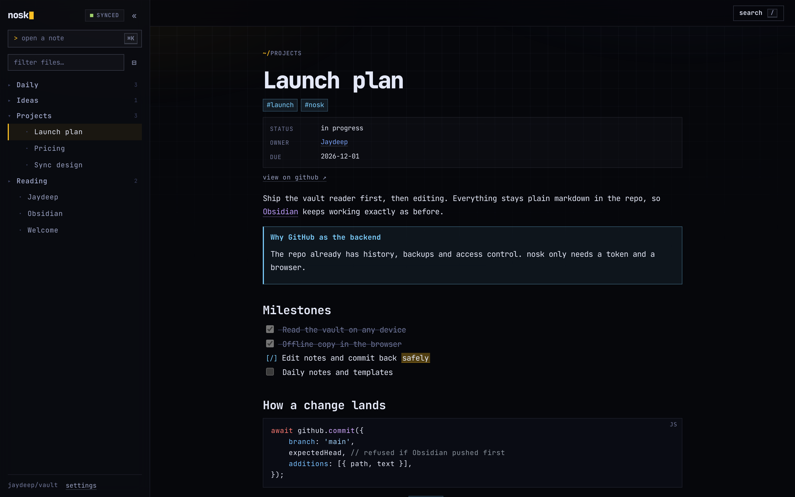
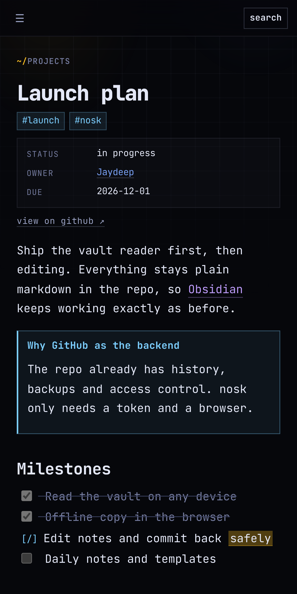

# nosk

**Your Obsidian vault, on every device.**

nosk opens your Obsidian vault straight from its GitHub repo, in any browser: laptop, desktop or
phone. Nothing to install, no sync subscription, no server. Your notes stay plain markdown in a
repo you own, and Obsidian keeps working exactly as before.

**[nosk.jaydeepganatra.dev →](https://nosk.jaydeepganatra.dev)**



## Why nosk

You already sync your vault to GitHub. That repo has history, backups and access control built
in, so it can be the backend. nosk is the missing piece: a fast reader that turns the repo into
your notes, anywhere you have a browser.

## What it does

- **Instant, and offline.** The first visit downloads your vault in seconds. After that it opens
  from your device and checks GitHub for changes with a single request. No signal? Everything
  still opens.
- **Reads Obsidian like Obsidian.** Wikilinks and aliases, embedded notes and images, callouts,
  tasks (including custom states), tags, highlights, math, code, properties and backlinks.
- **Find anything.** Jump to a note with `⌘K`, search every word with `/`, filter by `#tag`.
- **Your folders, as they are.** The sidebar mirrors the vault's folders, with a filter that
  matches as you type.
- **Private by design.** Your token stays in your browser and only ever talks to
  `api.github.com`. No accounts, no analytics, nothing in between.
- **Feels like an app on your phone.** Add it to your home screen and it opens full-screen.

<p align="center"></p>

## Get started

1. Create a [fine-grained GitHub token](https://github.com/settings/personal-access-tokens/new)
   with access to **only your vault repo** and **Contents: Read and write**.
2. Open **[nosk.jaydeepganatra.dev](https://nosk.jaydeepganatra.dev)**.
3. Enter your vault repo (`you/your-vault`) and paste the token. That's it.

## What's next

- **Editing.** Write in nosk and commit straight to the repo. A change only lands on the version
  it was made from, so nosk can never overwrite something Obsidian pushed first.
- **Daily notes and templates**, following your vault's own settings.
- **History**: browse and restore any earlier version of a note from git.

## Run it yourself

nosk is a static site with no build step.

```bash
cd frontend && python3 -m http.server 3000   # open http://localhost:3000
cd frontend && npm install && npm test        # tests
```
